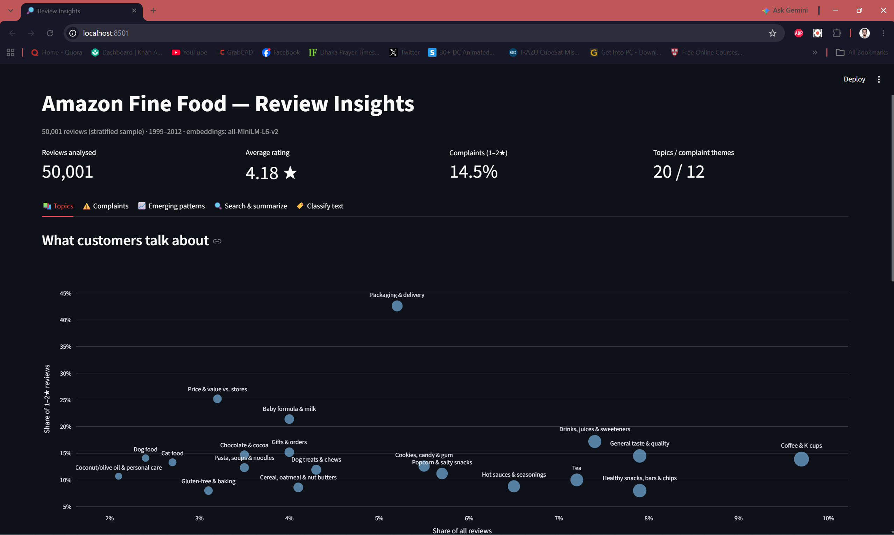

# NLP-Based Insights from Unstructured Data

Turning 568K Amazon Fine Food reviews into business insights: **what customers talk about,
why they complain, and which problems are growing**. The results are served through a
FastAPI service and an interactive Streamlit dashboard.

> Not another sentiment classifier: the goal is *actionable* insight from free text.

---

## Key findings

| # | Finding | Evidence |
|---|---------|----------|
| 1 | **Packaging & delivery is the most negative topic**: 43% of its reviews are 1–2★, about 3× the average (14.5%). | Topic clustering |
| 2 | **About a third of complaints are not about the food itself** but about delivery, packaging damage, pod hardware and price. | Theme × driver heatmap |
| 3 | **46% of coffee complaints are pod/brewing failures** (leaking, clogging), not taste. That's a packaging fix, not a recipe fix. | Complaint drivers |
| 4 | **Three complaint drivers grew significantly** from 2008–10 to 2011–12: coffee pods (6.8% → 8.7%), quantity/size (1.3% → 2.5%), "not as described" (0.6% → 1.4%). All p < 0.01. | Two-proportion z-test |
| 5 | **Chronic issues are stable**: taste (~42% of complaints), ingredients (~14%) and packaging (~7%) didn't change, so they're structural rather than emerging. | Two-proportion z-test |
| 6 | **A pet-safety cluster** of dog treats sourced from China: 46% of that theme mentions pets getting sick. It rose 18% but not significantly, so it's flagged for monitoring. | Complaint themes |

---

## What it does

| Capability | Method |
|---|---|
| Semantic understanding | `all-MiniLM-L6-v2` sentence embeddings (384-d) |
| Topic discovery | K-Means on embeddings (k = 20) + **c-TF-IDF** keywords, human-validated labels |
| Complaint themes | Second clustering on 1–2★ reviews only (k = 12) |
| Complaint drivers | **Zero-shot, sentence-level classification**: each sentence is matched to 14 business categories described by seed phrases (no labelled data; 77% coverage) |
| Emerging patterns | Share-of-complaints trend 2008–10 vs 2011–12 + two-proportion z-test |
| Semantic search | Cosine similarity over embeddings, with sentiment / topic / year filters |
| Summarization | Extractive, **MMR** (maximal marginal relevance): relevant but non-redundant sentences, each traceable to a review |
| Routing new text | Nearest topic centroid + per-sentence driver tagging (for support-ticket triage) |

---

## Architecture

```
Reviews.csv (568K)
   │  clean · de-duplicate (−30%) · stratified sample (50K by star × year)
   ▼
sentence embeddings (MiniLM, 384-d)
   ├──► K-Means → 20 topics  ──► c-TF-IDF keywords + labels
   ├──► 1–2★ only → K-Means → 12 complaint themes
   └──► sentences of 1–2★ → zero-shot → 14 complaint drivers → trends + z-test
                         │
                         ▼
            src/insights_service.py   (search · summarize · classify)
                 ┌───────┴────────┐
          api/main.py          app/dashboard.py
           (FastAPI)              (Streamlit)
```

---

## Project structure

```
├── data/raw/Reviews.csv          # dataset (not in git, see Setup)
├── artifacts/                    # generated outputs (embeddings, labels, JSON)
├── notebooks/
│   ├── 01_explore.ipynb          # cleaning, de-duplication, stratified sample
│   ├── 02_embeddings.ipynb       # sentence embeddings + first semantic search
│   ├── 03_topics.ipynb           # clustering, c-TF-IDF, topic labels
│   ├── 04_complaints.ipynb       # complaint themes, drivers, trends, significance
│   └── 05_service.ipynb          # tests for the service layer
├── src/
│   ├── nlp_utils.py              # c-TF-IDF, sentence splitting, trend helpers
│   ├── aspects.py                # complaint-driver definitions (editable)
│   └── insights_service.py       # shared search / summarize / classify logic
├── api/main.py                   # FastAPI app
├── app/dashboard.py              # Streamlit dashboard
└── requirements.txt
```

---

## Setup

```bash
python -m venv .venv
# Windows
.\.venv\Scripts\Activate.ps1
# macOS/Linux
source .venv/bin/activate

pip install -r requirements.txt
```

Download `Reviews.csv` from [Kaggle: Amazon Fine Food Reviews](https://www.kaggle.com/datasets/snap/amazon-fine-food-reviews)
and place it in `data/raw/`.

## Reproduce the analysis

Run the notebooks in order: `01` → `02` → `03` → `04`. Step 02 (embedding 50K reviews)
takes about 10–15 minutes on a CPU; everything else takes a few minutes.

## Run the API

```bash
uvicorn api.main:app --reload
```

Interactive docs: http://127.0.0.1:8000/docs

| Method | Endpoint | Purpose |
|---|---|---|
| GET | `/health` | Service status |
| GET | `/overview` | Dataset KPIs |
| GET | `/topics`, `/topics/{id}` | Discovered topics |
| GET | `/complaints/themes` | Complaint clusters |
| GET | `/complaints/drivers` | Driver shares + example quotes |
| GET | `/complaints/emerging` | Statistically significant growing drivers |
| GET | `/search?q=...` | Semantic search with filters |
| POST | `/summarize` | Extractive summary for a query or topic |
| POST | `/classify` | Route new text to a topic + drivers |

## Run the dashboard



```bash
streamlit run app/dashboard.py
```

Tabs: **Topics** · **Complaints** · **Emerging patterns** · **Search & summarize** · **Classify text**

---

## Limitations & future work

- **Embeddings capture topic more than polarity**: "my dog got sick" and "my dog is no longer sick" sit close together, so complaint analysis filters to 1–2★ first.
- **K-Means forces every review into a cluster**; a density-based method (HDBSCAN) would leave noise out.
- **Zero-shot drivers depend on the seed phrases**; a small labelled set would allow measuring precision and recall.
- **Extractive summaries** occasionally pick a weak sentence; an LLM-based RAG summarizer could produce fluent abstracts while keeping citations.
- **The data ends in 2012**; the pipeline is designed to be re-run on fresh data.
- **Multiple testing**: with Bonferroni correction across 14 drivers, only quantity/size stays significant at α = 0.05.

## Tech stack

Python · pandas · scikit-learn · sentence-transformers · FastAPI · Streamlit · Plotly